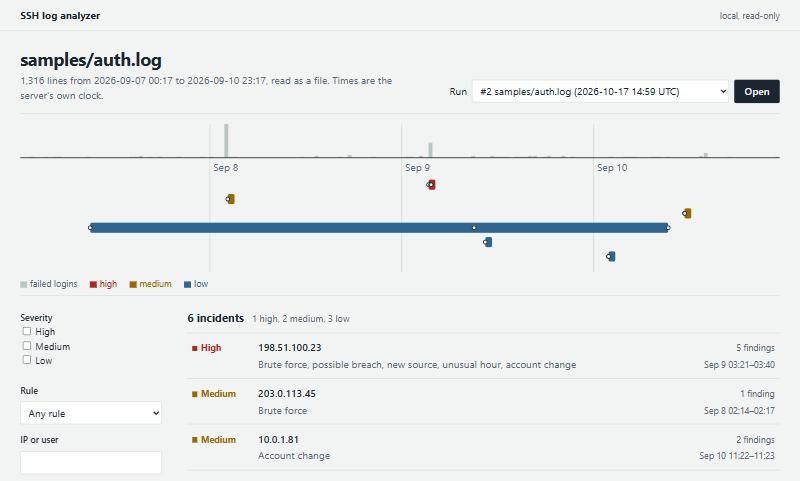
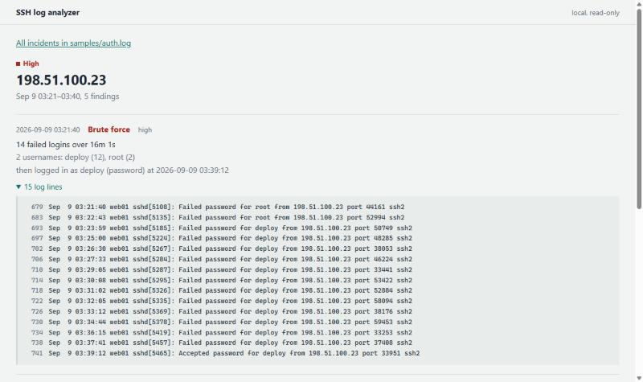

# SSH Log Analyzer

A command-line tool that reads a Linux SSH `auth.log` and reports suspicious activity:

1. **Brute force**: many failed logins from one IP in a short time.
2. **Password spray**: many real accounts tried a few times each from one source, slowly enough to dodge brute-force limits.
3. **Distributed brute force**: one account guessed from many sources, each staying under the per-source limit.
4. **Possible breach**: a successful login from an IP that was failing just before.
5. **New source**: a login from a network the user has never logged in from, the way stolen credentials usually look.
6. **Unusual hour**: a successful login in the middle of the night.
7. **Account change**: a new user, or a user given admin rights, flagged high when it comes from an IP that broke in.
8. **Log tampering**: hours of silence, timestamps jumping back, NUL-damaged lines: traces of lines deleted from or spliced into the log.

Findings are grouped by source, so one attacker's activity reads as one incident: brute force, then break-in, then the backdoor account. Each rule's false positives are measured on labelled data and documented: see [docs/detections.md](docs/detections.md) and [docs/evaluation.md](docs/evaluation.md).

It is plain Node.js with no dependencies and nothing to install.

## Running it

Requires Node.js 22.13 or later (24 recommended).

```sh
node bin/analyze.js samples/auth.log            # terminal report
node bin/analyze.js samples/auth.log --json     # machine-readable output
sudo cat /var/log/auth.log | node bin/analyze.js -   # read from stdin
sudo node bin/analyze.js --follow /var/log/auth.log  # watch live, report incidents as they happen
npm test                                        # run the tests
npm run generate-sample                         # rebuild samples/auth.log
```

```text
Options:
  --json              Print the results as JSON (with --follow: one JSON object per line)
  --follow            Keep watching the log, through rotation, and report incidents as they happen
  --from-start        With --follow, read what is already in the file first
  --discord           Send alerts to the Discord webhook in DISCORD_WEBHOOK_URL (or .env)
  --config <file>     Settings file (default log-analyzer.config.json, if it exists)
  --print-config      Print the effective settings as a config file and exit
  --threshold <n>     Failed logins from one IP that count as brute force (default 5)
  --window <time>     ...within this window, e.g. 90s, 10m, 1h (default 10m)
  --lookback <time>   How far before a login to look for failures (default 30m)
  --night <from-to>   Unusual login hours on a 24h clock, end excluded (default 1-5)
  --admin-groups <g>  Comma-separated groups that grant admin rights (default sudo,wheel,admin)
  --year <yyyy>       Year of the first line; syslog timestamps have none (default: guessed)
  -h, --help          Show this help
```

The exit status is 0 if nothing high-severity was found, 1 if something was, and 2 for bad arguments, a bad config file, or an unreadable log, so the tool can gate a cron job or CI step.

### Configuration

Every rule's settings can go in one JSON file. Copy [log-analyzer.config.example.json](log-analyzer.config.example.json), which lists every setting at its default, to `log-analyzer.config.json` and change what you need. Unknown keys and wrong types are errors, not silently ignored, and durations always carry a unit (`"90s"`, `"10m"`, `"1h"`, `"7d"`). Flags override the file. For example, to stop the new-source and distributed rules from reporting your own internal networks:

```json
{ "trustedNetworks": ["10.0.0.0/8"] }
```

### Live mode

`--follow` watches the log as it is written, like `tail -F`, and reports each incident as it opens, escalates (a brute force becoming a break-in), or gains a new kind of finding:

```text
2026-10-17 10:46:37  MEDIUM (new)  172.30.0.77  brute force: 5 failed logins over 13s
                                   2 usernames: deploy (3), root (2)
                                   never logged in
2026-10-17 10:46:37  HIGH (now)    172.30.0.77  brute force: 10 failed logins over 28s
                                   2 usernames: deploy (8), root (2)
                                   then logged in as deploy (password) at 2026-10-17 10:47:07
2026-10-17 10:47:07  HIGH (also)   172.30.0.77  possible breach: deploy logged in (password) after 10 failed logins in the previous 30s
2026-10-17 10:47:09  HIGH (also)   172.30.0.77  account change: new user sysupdate, member of sudo
                                   by deploy via sudo, in a session from 172.30.0.77
                                   172.30.0.77 broke in as deploy at 2026-10-17 10:47:07 after 10 failed logins
```

That is the Docker-lab break-in, replayed into a file a few lines at a time: the attack is reported at its fifth guess, escalated when the attacker gets in, and the backdoor account joins the same incident. `(also)` lines are new findings in an incident that is already open; they don't send a second Discord alert.

It survives logrotate in both modes (rename-and-create, and copytruncate) and the file briefly disappearing. It reports the file shrinking with no rotated copy beside it as log tampering, at high severity. Memory stays flat, because rule state is bounded and incidents close after 24 hours without news (`live.incidentIdle`). Ctrl+C or SIGTERM stops it cleanly: it reads what is left, closes the open incidents, and gives pending alerts up to 5 seconds. With `--json`, each incident event is one JSON object per line, for piping into other tools.

### Discord alerts

`--discord` sends one alert when an incident opens at medium or above, and one more when it escalates: one attack is one alert, however many lines it writes. Alerts are queued and rate-limited (5 at once, then 20 a minute), retried with backoff when Discord is busy, and never slow detection down. Log content in an alert sits inside a code block with mentions disabled, so a username like `@everyone` or a markdown link stays inert text.

To set it up, create a webhook in Discord (Server Settings → Integrations → Webhooks → New Webhook → Copy Webhook URL). Then put it in a `.env` file next to where you run the tool. `.env` is git-ignored, and [.env.example](.env.example) shows the format:

```sh
DISCORD_WEBHOOK_URL=https://discord.com/api/webhooks/<id>/<token>
```

The tool reads it with Node's own `.env` support and never prints it. Thresholds live in the config file under `discord` (`minSeverity`, `burst`, `perMinute`). `--discord` also works without `--follow`, sending one alert per incident in the report, which suits a nightly cron job.


### Storing results (SQLite)

`--db runs.db` also stores the run in a SQLite file: every line, the events parsed from them, and the incidents and findings. It works for a one-off analysis and with `--follow`, where each incident is updated as it changes. It uses Node's built-in `node:sqlite`, so nothing extra is installed, and is loaded only when asked for (on Node 22, `node:sqlite` still prints an experimental warning). All SQL is parameterized: log content is always data.

```sh
node bin/analyze.js samples/auth.log --db runs.db
```

Two rules, brute force and unusual hour, are also written in SQL (`src/io/sql-rules.js`). They are a second, independent implementation. Tests require them to produce exactly the findings of the JavaScript rules on the sample, the lab recording, 29 corpus logs, and 300 random event streams. The one exception is logs with spliced lines, which the tampering rule reports: there the streaming engine follows file order while SQL orders by time ([ADR-0015](docs/adr/0015-sqlite-storage.md)).
### Dashboard

A local web view of a database written with `--db`: a timeline of failed logins with each incident marked on it, filters by severity, rule and IP or username, and every incident's findings down to the raw log lines behind them.

```sh
node bin/analyze.js samples/auth.log --db runs.db
npm run dashboard -- --db runs.db      # http://127.0.0.1:4797/ (--port, --ipv6)
```





Log content is hostile, so the dashboard is deliberately narrow ([ADR-0016](docs/adr/0016-local-read-only-dashboard.md)): it listens on loopback only and answers only its own `Host` (against DNS rebinding) and not requests from other sites, serves GET and HEAD only, opens the database read-only, and sends no JavaScript at all, under a Content-Security-Policy of `default-src 'none'`. Every log field is escaped, including control characters and bidi overrides; tests render hostile usernames into every page and check they come out as text.

## Example: one attacker, start to finish

`samples/auth.log` is four days of synthetic activity on a small web server, with attacks hidden among normal traffic. This is how the analyzer reports attacker B:

```text
HIGH    198.51.100.23
  2026-09-09 03:21:40  brute force      14 failed logins over 16m 1s
                                        2 usernames: deploy (12), root (2)
                                        then logged in as deploy (password) at 2026-09-09 03:39:12
                                        ATT&CK T1110.001 Brute Force: Password Guessing
  2026-09-09 03:39:12  possible breach  deploy logged in (password) after 14 failed logins in the previous 17m 32s
                                        ATT&CK T1110.001 Brute Force: Password Guessing, T1078.003 Valid Accounts: Local Accounts
  2026-09-09 03:39:12  new source       deploy logged in (password) from 198.51.100.0/24, a network not seen for deploy before
                                        previously from 1 other network
                                        ATT&CK T1078.003 Valid Accounts: Local Accounts, T1021.004 Remote Services: SSH
  2026-09-09 03:39:12  unusual hour     deploy logged in (password) at 03:39
                                        ATT&CK T1078.003 Valid Accounts: Local Accounts
  2026-09-09 03:40:56  account change   new user sysupdate, member of sudo
                                        by deploy via sudo, in a session from 198.51.100.23
                                        198.51.100.23 broke in as deploy at 2026-09-09 03:39:12 after 14 failed logins
                                        ATT&CK T1136.001 Create Account: Local Account, T1098.007 Account Manipulation: Additional Local or Domain Groups
```

In words: B guessed the `deploy` account's password over about 17 minutes, logged in at 3:39 AM from a network `deploy` had never used, and less than two minutes later created a new sudo user called `sysupdate` as a backdoor. Five rules fire, and they appear together under one IP, each labelled with the MITRE ATT&CK techniques it is evidence of ([docs/detections.md](docs/detections.md)).

<details>
<summary>Full report for the sample log</summary>

```text
SSH auth log analysis: samples/auth.log
1,316 lines, 2026-09-07 00:17:01 to 2026-09-10 23:17:02
116 failed logins, 44 successful logins

Rules:
  brute force      5+ failed logins from one IP within 10m
  possible breach  a login from an IP with failed logins in the previous 30m
  unusual hour     a login between 01:00 and 04:59
  account change   a new user, or a user added to sudo/wheel/admin; high if made from an IP that broke in
  password spray   6+ real accounts from one source within 1h, at most 2 tries each
  distributed      one account guessed from 4+ sources (8+ failures) within 1h
  new source       a login from a network the user hasn't logged in from before (after 24h of learning)
  log tampering    no lines for 2h, time going back 5m+, NUL bytes, or truncation

HIGH    198.51.100.23
  2026-09-09 03:21:40  brute force      14 failed logins over 16m 1s
                                        2 usernames: deploy (12), root (2)
                                        then logged in as deploy (password) at 2026-09-09 03:39:12
                                        ATT&CK T1110.001 Brute Force: Password Guessing
  2026-09-09 03:39:12  possible breach  deploy logged in (password) after 14 failed logins in the previous 17m 32s
                                        ATT&CK T1110.001 Brute Force: Password Guessing, T1078.003 Valid Accounts: Local Accounts
  2026-09-09 03:39:12  new source       deploy logged in (password) from 198.51.100.0/24, a network not seen for deploy before
                                        previously from 1 other network
                                        ATT&CK T1078.003 Valid Accounts: Local Accounts, T1021.004 Remote Services: SSH
  2026-09-09 03:39:12  unusual hour     deploy logged in (password) at 03:39
                                        ATT&CK T1078.003 Valid Accounts: Local Accounts
  2026-09-09 03:40:56  account change   new user sysupdate, member of sudo
                                        by deploy via sudo, in a session from 198.51.100.23
                                        198.51.100.23 broke in as deploy at 2026-09-09 03:39:12 after 14 failed logins
                                        ATT&CK T1136.001 Create Account: Local Account, T1098.007 Account Manipulation: Additional Local or Domain Groups

MEDIUM  203.0.113.45
  2026-09-08 02:14:10  brute force      36 failed logins over 2m 58s
                                        16 usernames, 15 nonexistent: root (18), admin (4), administrator (1), ftpuser (1), git (1), +11 more
                                        never logged in
                                        ATT&CK T1110.001 Brute Force: Password Guessing

MEDIUM  10.0.1.81
  2026-09-10 11:22:17  account change   new user erin
                                        by dave via sudo, in a session from 10.0.1.81
                                        ATT&CK T1136.001 Create Account: Local Account
  2026-09-10 11:23:53  account change   erin added to sudo
                                        by dave via sudo, in a session from 10.0.1.81
                                        ATT&CK T1098.007 Account Manipulation: Additional Local or Domain Groups

LOW     10.0.1.57
  2026-09-07 09:01:50  possible breach  bob logged in (password) 6s after 1 failed login
                                        ATT&CK T1110.001 Brute Force: Password Guessing, T1078.003 Valid Accounts: Local Accounts
  2026-09-09 09:03:04  possible breach  bob logged in (password) 5s after 1 failed login
                                        ATT&CK T1110.001 Brute Force: Password Guessing, T1078.003 Valid Accounts: Local Accounts
  2026-09-10 09:19:38  possible breach  bob logged in (password) 6s after 1 failed login
                                        ATT&CK T1110.001 Brute Force: Password Guessing, T1078.003 Valid Accounts: Local Accounts

LOW     2001:db8:4a2::/64
  2026-09-09 10:27:32  new source       carol logged in (publickey) from 2001:db8:4a2::/64, a network not seen for carol before
                                        previously from 1 other network
                                        ATT&CK T1078.003 Valid Accounts: Local Accounts, T1021.004 Remote Services: SSH

LOW     10.8.0.22
  2026-09-10 01:52:13  new source       dave logged in (publickey) from 10.8.0.0/24, a network not seen for dave before
                                        previously from 1 other network
                                        ATT&CK T1078.003 Valid Accounts: Local Accounts, T1021.004 Remote Services: SSH
  2026-09-10 01:52:13  unusual hour     dave logged in (publickey) at 01:52
                                        ATT&CK T1078.003 Valid Accounts: Local Accounts

6 incidents: 1 high, 2 medium, 3 low
```

</details>

## The detections

| Rule | Fires when | Default | Severity |
|---|---|---|---|
| Brute force | failed logins from one source within a sliding window | 5 in 10 minutes | medium; high if that source later logs in |
| Password spray | failures for many existing accounts from one source, few tries each | 6 accounts in 1 hour, ≤ 2 tries each | medium; high on a login as one of them |
| Distributed brute force | failures for one account from many sources | 4 sources and 8 attempts in 1 hour | medium; high on a login from one of them |
| Possible breach | a successful login, and the same source failed in the time before it | 30-minute lookback | low for 1–4 failures; high for 5+ or during a brute force |
| New source | a login from a network (/24 or /64) the user never logged in from | after 24 hours of learning | low for keys, medium for passwords |
| Unusual hour | a successful SSH login during the night window | 01:00–04:59 | low |
| Account change | a new user, or a user added to an admin group | groups `sudo`, `wheel`, `admin` | low for a plain user; medium for admin rights or UID 0; high if made from an IP that broke in |
| Log tampering | no lines for hours, time going back, NUL-damaged lines, a truncated file | gap 2 hours, step back 5 minutes | low, medium, high for truncation |

The first four rules below are described in detail here. The rest, and the tuning options and known false positives of every rule, are in **[docs/detections.md](docs/detections.md)**.

### Measured quality

On a labelled corpus of 40 synthetic three-day logs (157 attacks, many deliberately below the thresholds, plus benign lookalikes) and on the Docker-lab recording, with default settings ([full results](docs/evaluation.md), regenerated and checked by CI):

| Rule | Recall | Precision | Where it misses / what trips it |
|---|---|---|---|
| Brute force | 89% | 95% | misses 3–4 guesses; trips on several typos behind one NAT |
| Password spray | 69% | 100% | misses sprays of 3–5 accounts (below the default of 6) |
| Distributed brute force | 56% | 62% | misses 2–3 sources; trips on a misconfigured internal service (94% precision once internal networks are trusted) |
| New source | 100% | 38% | trips on travel and on the first users through an office NAT; inherent, hence never high |
| Log tampering | 96% | 76% | misses holes shorter than 2 hours; trips on maintenance downtime |

On the lab recording every labelled attack is caught with no false positives. The corpus was written by the same person as the rules, so it can only contain cases that were thought of: these numbers show where the thresholds sit, not how the tool will do on real traffic.

### Brute force

Five or more failed logins from one IP within ten minutes, which are also fail2ban's defaults. Overlapping windows merge into one finding per attack, which lists the usernames tried and how many of them don't exist on the server.

The hard part is counting correctly. sshd records one failed attempt on several lines: a PAM "authentication failure" line, an "Invalid user" line, and a "Failed password" line. Only the `Failed …` line is counted; counting all of them would roughly double the total. The system logger also collapses repeated identical lines into `message repeated 5 times: [ … ]`, and that one line counts as five failures. In the sample, 16 of attacker A's 36 failures appear only inside such lines.

The rule uses a sliding window rather than a total for the whole file. With a total, a user who mistypes their password five times over a month would look like an attacker.

### Possible breach

For every successful login, the rule counts failed logins from the same IP in the previous 30 minutes. The severity split is what makes this rule useful. One failure a few seconds before a login is almost always a typo, as with bob in the sample, so it is low. Five or more, or a login during a brute force from that IP, is how a successful password-guessing attack looks, so it is high.

### Unusual hour

Successful SSH logins from 01:00 to 04:59, by the server's own clock. Times are never converted between timezones: "3 AM" means 3 AM where the server is. Cron jobs and other non-SSH sessions at night are ignored. The rule is low severity on its own, because it is context: it adds weight to a breach, and without one it is often just the on-call admin. The end hour is excluded so that the sample's nightly 05:30 backup job isn't flagged every day. Windows that cross midnight work too, for example `--night 22-6`.

### Account change

This rule watches the lines written by the standard account tools: `useradd` (a new user, plus any groups given with `-G`), `usermod -aG` and `gpasswd -a`. `adduser` is covered through the `useradd` and `gpasswd` calls it makes. It reports:

- **a new user**: low;
- **a user added to an admin group** (`sudo`, `wheel`, `admin`), **or a new user with UID 0**, which is a second root account: medium;
- **either of the above made from an IP that had already broken in**: high.

Being added to any other group, such as `docker`, is ignored. You can change the list of admin groups with `--admin-groups`.

## How the account-change rule finds the source IP

`useradd` and `usermod` don't record who ran them or from where. The log just says:

```text
useradd[5474]: new user: name=sysupdate, UID=1101, GID=1101, home=/home/sysupdate, shell=/bin/bash, from=/dev/pts/1
useradd[5474]: add 'sysupdate' to group 'sudo'
```

To tell whether the change followed a break-in, the rule has to work out the source IP itself. It takes four steps.

1. **Group the lines.** `useradd -G sudo` writes the new user and the group on separate lines from the same process. Lines with the same process ID and target user are merged into one change.

2. **Find who ran it.** The rule looks back for the most recent `sudo` line that:
   - is at most one minute earlier (`adduser` asks questions, so it allows time for typing),
   - runs one of `useradd`, `adduser`, `usermod` or `gpasswd`, and
   - names the same target user in its arguments.

   sudo logs the user who invoked it, so that gives the person:
   ```text
   sudo:   deploy : TTY=pts/1 ; PWD=/home/deploy ; USER=root ; COMMAND=/usr/sbin/useradd -m -s /bin/bash -G sudo sysupdate
   ```

3. **Rebuild the SSH sessions.** Every `Accepted …` line opens a session with a user, an IP and a start time. The line that ends it, `session closed for user deploy`, has no IP. But the same sshd process writes both lines, so they are matched by process ID. A session with no closing line counts as open until the end of the log.
   ```text
   sshd[5465]: Accepted password for deploy from 198.51.100.23 port 33951 ssh2
   sshd[5465]: pam_unix(sshd:session): session closed for user deploy
   ```

4. **Put them together.** The rule takes that person's sessions that were open when the change happened and collects their IPs. If any of those IPs had a high-severity possible breach before the change, the change is high and joins that IP's incident.

For attacker B: `deploy` logs in from 198.51.100.23 at 03:39 after 14 failed guesses. At 03:40 `deploy` runs `sudo useradd -G sudo sysupdate`. `deploy`'s only open session at that moment is the one from 198.51.100.23; the CI system's earlier `deploy` sessions had already closed. So the change is high severity, and it is reported under B's IP.

Only the sudo user's sessions are considered. That way, if an admin makes a legitimate change while an attacker happens to be logged in, the admin's action isn't blamed on the attacker's session. The sample includes this kind of legitimate change: dave onboards a new hire from the office and is reported as medium, not high.

**Limits:**
- If the change is made from a root shell (`sudo -i`, then `useradd`), there is no matching sudo line. The rule falls back to every open SSH session. It still escalates if a breached session is open, but the attribution is looser.
- If one user has sessions open from two IPs at once, the log doesn't say which terminal ran the command. Both IPs are reported, and the change is high if either IP broke in.
- Only a high-severity breach escalates a change. A login right after a single mistyped password doesn't.

## How it works inside

The code is a functional core with an imperative shell. Parsing and detection (`src/core/`) are pure and deterministic, with no I/O, no clock and no randomness, and a lint rule enforces that. Reading files, printing and exit codes live at the edges (`bin/`, `src/io/`).

The four rules run on a **streaming engine**. Lines are read one at a time, parsed, and pushed into the engine; events are never collected into a list. Each rule keeps only the state it needs, such as one window of recent failures per IP or the SSH sessions currently open. That state is dropped as the log's own clock moves on, so memory doesn't grow with the length of the log. Findings appear as soon as a rule sees them and are updated when more evidence arrives. For example, a brute force is reported as medium and becomes high when the attacker logs in. This is what will let the same rules watch a live log.

Every kind of state also has a hard ceiling: 100,000 tracked IPs per rule, 5,000 recent failures per IP, 1,000 usernames per attack. Attacker IPs, breaches, and sessions with no logout are remembered for 7 days. If a ceiling is ever reached, for example by a botnet using more addresses than that, the oldest state is dropped and the report warns that activity may have been missed.

The engine was checked against the original implementation, which is kept unchanged in `test/reference/` for this purpose. A property-based test generates thousands of random event streams and requires both to report exactly the same incidents. The two differ in only three documented ways ([ADR-0007](docs/adr/0007-streaming-engine-with-bounded-state.md)): the 7-day memory; ties within the same second, where the engine uses only lines it has already read; and incidents at the same time and severity, which are ordered by IP.

## Log formats

- Classic syslog timestamps (`Sep  7 03:39:12`). These have no year. The first line takes `--year`, or else the most recent year that doesn't put it in the future. Each later line takes whichever year puts it closest to the line before, so New Year works in both directions: Dec 31 → Jan 1 moves to the next year, and a late Dec 31 line arriving after Jan 1 stays in the old one.
- RFC 3339 timestamps (`2026-09-07T03:39:12.123456+00:00`), used by newer Debian and Ubuntu. The offset is ignored so times stay on the server clock.
- `sshd`, and the `sshd-session` and `sshd-auth` processes used by OpenSSH 9.8 and later.
- IPv6 addresses, Windows (CRLF) line endings, and input from stdin.
- **Spoofed usernames.** Usernames come from the attacker and can contain text like `from 10.0.0.1 port 22`. The parser always takes the *last* `from … port …` on the line, which sshd itself writes.
- Lines in no recognized format are counted and reported, not treated as errors.
- **Hostile input.** Lines over 8 KiB are skipped and counted rather than buffered; sshd's own lines are far shorter. Every log-derived field in the terminal report is escaped, so a forged line can't send terminal escape sequences, fake extra report lines with newlines, or reorder text with Unicode bidi overrides. Adversarial lines of 7–8 KB parse in well under 5 ms each, and a test enforces that.

### Speed and memory

`npm run bench` generates a deliberately hostile synthetic log in memory: 70% of lines are single guesses from ever-new random IPs, as from a large botnet, mixed with brute-force bursts, logins, logouts and sudo noise. It then analyzes it. Measured on my Windows laptop with Node 24.21:

| 1M lines, all eight rules | time | live heap after GC at 25 / 50 / 75 / 100% |
|---|---|---|
| streaming (current) | 11.2 s, ~89,000 lines/s | 45 / 47 / 45 / 43 MB |
| collect, then analyze (the v0.1.0 approach) | 8.3 s | 93 / 182 / 270 / 360 MB |

Streaming trades some speed for flat memory. Part of the gap is that the collect path can't run the log-tampering rule, which needs every line rather than only authentication events. With the original four rules only, the streaming run took 8.4 s. At 4M lines the streaming run's live heap is 43 / 50 / 56 / 57 MB at each million. The slow rise fits the findings kept for the final report, which grow with the number of attacks rather than lines (not yet measured separately). Resident memory (RSS) is higher than the live heap in both cases, because V8 holds on to memory it has freed.

## Testing

### Sample data with a known answer key

[`scripts/generate-sample-log.js`](scripts/generate-sample-log.js) writes `samples/auth.log`. It uses a fixed random seed, so every run produces the same file and the expected results are always known. The normal background includes:
- five users logging in with keys or passwords and running sudo,
- cron jobs and CI deploys,
- 60 internet scanners, each making at most two password guesses.

External addresses come from the IP ranges reserved for documentation (RFC 5737), so no real host appears. Hidden inside are:

| | Scenario | Expected |
|---|---|---|
| A | Dictionary attack: 36 guesses at root and common account names; never gets in | brute force (medium) |
| B | Targeted guessing of `deploy`, logs in at 03:39, creates the sudo user `sysupdate` | all four rules (high) |
| C | On-call admin logs in over the VPN at 01:52 | unusual hour (low) |
| D | 4 failed guesses | nothing: one below the threshold |
| E | Nightly backup job logs in at 05:30 | nothing: just outside the night window |
| F | bob mistypes his password once, then logs in (3 times) | possible breach (low) |
| G | Admin creates a new hire's account, gives her sudo, adds bob to `docker` | account change (low and medium); `docker` ignored |

C through G are deliberate lookalikes. They check that the analyzer is right about what it *doesn't* flag, not only about what it does.

The sample predates the newer rules, which find three more things in it. The new-source rule reports B's login as `deploy` from a network `deploy` had never used, a true positive. It also reports two benign lookalikes at low severity, which are honest examples of that rule's inherent false positives: carol logging in from home over IPv6, and dave's on-call login over the VPN (C). The newer rules are measured on a separate labelled corpus instead (see [Measured quality](#measured-quality)).

### Real logs from a Docker lab

The synthetic sample only contains formats the generator knows about, so the analyzer is also tested on logs written by the real software. [`lab/`](lab/README.md) is a Docker Compose lab: a Debian 13 server running OpenSSH 10 and rsyslog, an office workstation, and attackers on nine addresses, on an internal network with no route out. Its scenarios are normal admin work, a dictionary attack, a break-in that ends with a backdoor sudo user, a password spray across ten accounts, and a distributed attack on one account from five addresses.

`npm run lab` builds it, plays the scenarios, copies out `/var/log/auth.log` and checks it against [labels](test/fixtures/lab/labels.json). CI does this on every pull request, and one recorded run is committed as a test fixture. The lab confirmed that the parser handles current formats (`sshd-session`, sudo 1.9 lines with no `TTY=`, RFC 3339 timestamps). It also exposed a false positive, since fixed: on a shared office IP, a colleague's key login right after someone else's typo counted as a possible breach.

### Test suites

120 tests using Node's built-in `node:test`. Run them with `npm test`.

- `test/parse.test.js`: each line type, `message repeated` counting, spoofed usernames, IPv6, RFC 3339, the December-to-January year change, unreadable lines.
- `test/detectors.test.js`: each rule's thresholds and boundaries (4 vs 5 failures, a window exactly 10 minutes wide, 00:59 vs 01:00 vs 05:00), plus each way an account change can or can't be linked to a break-in.
- `test/lab-fixture.test.js`: the recorded lab log produces exactly its labelled incidents, the label check fails when an attack step is removed or an unlabelled attack is added, and current OpenSSH/sudo formats parse.
- `test/engine-equivalence.test.js`: fast-check generates thousands of random event streams (attacks, logins, sessions, sudo and account changes on a few IPs and users) and requires the engine and the frozen original rules to agree.
- `test/engine.test.js`: incremental findings, state staying under its caps with 100,000 attacking IPs, eviction as the log clock moves, the 7-day memory, and the same-second logout case the random test can't reach.
- `test/hostile-input.test.js`: lines split mid-character, the line-length cap (a 50 MB line never buffers more than 8 KiB), adversarial regex input under a time budget, escaped terminal output, and year inference.
- `test/rules.test.js`: the newer rules, each with what it must catch and the lookalikes it must not: scanner noise and office-NAT typos for spraying; roaming users, nonexistent accounts and IPv6 address rotation for distributed attacks; learning, first logins, shared and trusted networks for new sources; NTP steps and DST for tampering.
- `test/config.test.js`: the config file round trip, rejection of typos and wrong types, flags overriding the file, and the IP and network helpers.
- `test/follow.test.js`: the follower on real files: partial lines, rotation by rename, copytruncate, truncation, a file that disappears.
- `test/live-incidents.test.js`, `test/live.test.js`: incident events (one opened, one escalated), shutdown, truncation as tampering, the CLI with `--follow --json` and SIGTERM, `--discord` with the URL from `.env`, and a 100,000-line soak run with state bounded.
- `test/discord.test.js`: the Discord sink against a local mock webhook: dedup, hostile content kept inert, 429 with `retry_after`, 5xx retries, 4xx not retried, a slow server not blocking the caller, the rate limit, a full queue, and a hanging server at shutdown.
- `test/store.test.js`, `test/sql-rules.test.js`: what `--db` stores, drill-down from a finding to its raw lines, hostile strings stored as data, the schema version, read-only access, live mode storage, and the SQL rules matching the JavaScript ones.
- `test/sample.test.js`: an end-to-end check that the sample log produces exactly the incidents in the table above, plus the command line (exit codes, `--json`, stdin, bad arguments).

### Planted-bug testing

Tests that have never failed haven't proved they can catch anything. So after each feature, I planted small bugs in the code on purpose, one at a time, and checked that at least one test failed. Examples:

- raising the brute-force threshold from 5 to 6;
- making the window edge exclusive;
- ignoring the count in `message repeated` lines;
- letting a break-in that happens *after* an account change escalate it;
- ignoring logouts, so sessions never close;
- ignoring which user ran sudo.

Of 11 planted bugs, two survived at first. Both were real gaps in the tests:

- **The spoofed-username test passed for the wrong reason.** The parser matches usernames greedily so that the last `from … port …` on the line wins. Switching to a lazy match should have broken the test, but it didn't: the test's fake username was rejected by the end-of-line anchor anyway. The test now uses a username containing `ssh2: …`, which a lazy match really does misread.
- **No test covered a break-in after the change.** Nothing checked that a break-in occurring *after* an account change leaves the change un-escalated. A test was added.

One lesson from the process: a planted bug that doesn't actually apply gives the same "0 tests failed" as a real gap. The script therefore checks that the source file really changed before trusting the result. That check caught one planted bug that hadn't applied.

The same was done for the streaming engine's new code paths, the ones with no counterpart in the original:

- never escalating a low possible breach when a brute force turns up later;
- ignoring a breach that became high after an account change;
- forgetting logins that came before an attack became visible;
- an exclusive window edge;
- forgetting low findings too soon;
- dropping a session whose PID is reused;
- not counting a session that logged out in the same second as the change.

The random equivalence test caught six of the seven. The seventh survived because the generator never puts two actions in the same second. A targeted test now covers it, and catches it.

For the four newer rules the tests were written alongside the rules rather than strictly first, so planted bugs were used to check them. Eleven were planted: off-by-one thresholds, counting nonexistent accounts, forgetting the typo exemption, alerting during learning, comparing exact addresses instead of networks, dropping the DST allowance, measuring gaps from the wrong line, never reporting a held-back login, and counting IPv6 per address. All eleven were caught. The labelled evaluation then found three bugs that no test had:

- steps across the end of DST misread as tampering when the lines were minutes apart;
- logins from trusted networks not building the new-source baseline;
- a flood of new-source alerts for every first login through an office NAT, fixed by treating a network that several colleagues use as known.

## Development

```sh
npm ci              # install the development tools (there are no runtime dependencies)
npm run check       # lint, type check and tests, exactly as CI runs them
```

- **Lint:** ESLint with the recommended rules plus `no-eval`, `no-implied-eval` and `no-new-func`.
- **Types:** JSDoc annotations checked by `tsc --checkJs` in strict mode. There is no build step; the `.js` files run as they are.
- **CI:** every pull request runs lint, type check, and tests on Node 22 and 24. `main` only accepts pull requests whose checks pass.

The plan and the reasoning behind it live in [SPEC.md](SPEC.md) (goals, non-goals, acceptance criteria), [PLAN.md](PLAN.md) (tasks and how each is verified) and [docs/adr/](docs/adr/) (architecture decision records).

## Project layout

```text
bin/analyze.js                  command line: options, reading the file or stdin, exit codes
src/core/                       the pure core: parser, year inference, engine, rules, incidents
src/core/rules/                 brute force, possible breach, unusual hour, account change
src/io/                         reading lines from files and stdin; the streaming analysis
src/io/follow.js, src/io/live.js  following a log through rotation; live mode
src/io/sinks/                   live outputs: terminal, JSON lines, Discord
src/io/store.js, sql-rules.js   SQLite storage, drill-down, and two rules in SQL
bin/dashboard.js, src/dashboard/  local read-only dashboard: server, queries, HTML views
src/parse.js, src/detectors.js  stable entry points: parseLines(), analyze()
src/report.js                   terminal and JSON output
src/types.js                    shared JSDoc types (events, findings, options)
scripts/generate-sample-log.js  synthetic auth.log with a known answer key
samples/auth.log                the generated sample
scripts/lab.js                  runs the Docker lab and checks its log against labels
lab/                            Docker lab: SSH target, clients, attack scenarios
scripts/bench.js                speed and memory benchmark
scripts/eval.js                 precision and recall on labelled data, written to docs/evaluation.md
scripts/lib/corpus.js           the seeded, labelled synthetic corpus
docs/detections.md              every rule: what it reads, tuning, false positives
log-analyzer.config.example.json  every setting at its default
test/                           parser, detector, engine, hostile-input, end-to-end and lab tests
test/reference/                 the original batch rules, frozen, as a test oracle
test/fixtures/lab/              a recorded lab auth.log and its labels
docs/adr/                       architecture decision records
```

## About this project

I built this to learn the fundamentals of SOC log analysis:
- how sshd, PAM, sudo and the account tools each write to the auth log;
- why raw line counts mislead;
- how to connect events across different processes when no single line tells the whole story;
- how to set thresholds so that real attacks stand out from everyday noise like typos and on-call logins.

Development is AI-assisted: I set the direction, the requirements and the standards, and review the results; much of the code is written with Claude Code, an AI coding assistant, working under that direction.

It is a learning project, not a production security tool. It has been tested against the synthetic logs and the Docker-lab logs described above, not real-world traffic. It can analyze a file after the fact or follow a live log. Lines in `auth.log` are not authenticated, so any local user can forge one with `logger -t sshd`, and the analyzer is only as trustworthy as the system logger. Its account attribution is a best guess, as described in the limits above. On a real system, this job belongs to tools like fail2ban, auditd and a SIEM. This project is about understanding what those tools are doing underneath.

## License

MIT. See [LICENSE](LICENSE).
