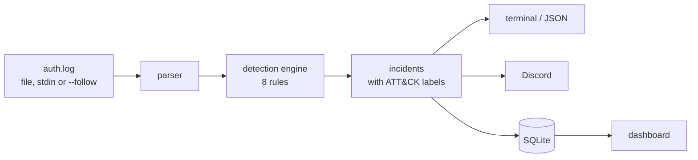

# SSH Log Analyzer

[](https://github.com/Athbba/log-analyzer/actions/workflows/ci.yml)


[](LICENSE)

**Reads a Linux SSH login log (`auth.log`) and tells you who attacked the server, how, and whether they got in.**

```sh
git clone https://github.com/Athbba/log-analyzer.git && cd log-analyzer
node bin/analyze.js samples/auth.log --db runs.db   # analyze a sample log and save the results
npm run dashboard -- --db runs.db                    # open http://127.0.0.1:4797/ to browse them
```

Needs Node.js 22.13 or later. Nothing else to install.


## What it does

Servers log every SSH login attempt. On a server facing the internet that is thousands of lines a day, and real attacks hide in the noise. The analyzer turns those lines into a short list of **incidents**: everything one attacker did, in order, with a severity.

Here is one attacker from the sample log. They guessed a password, got in at 3:39 AM, and two minutes later created a hidden admin account:

```text
HIGH    198.51.100.23
  2026-09-09 03:21:40  brute force      14 failed logins over 16m 1s
                                        2 usernames: deploy (12), root (2)
                                        then logged in as deploy (password) at 2026-09-09 03:39:12
                                        ATT&CK T1110.001 Brute Force: Password Guessing
  2026-09-09 03:39:12  possible breach  deploy logged in (password) after 14 failed logins in the previous 17m 32s
  2026-09-09 03:39:12  new source       deploy logged in (password) from 198.51.100.0/24, a network not seen for deploy before
  2026-09-09 03:39:12  unusual hour     deploy logged in (password) at 03:39
  2026-09-09 03:40:56  account change   new user sysupdate, member of sudo
                                        by deploy via sudo, in a session from 198.51.100.23
```

(Shortened: the real output gives every finding its [MITRE ATT&CK](https://attack.mitre.org/) technique. See the [full report](docs/usage.md#the-full-report-for-the-sample-log).)

## What it detects

| Detection | What it catches | ATT&CK |
|---|---|---|
| Brute force | many failed logins from one address | T1110.001 |
| Password spray | a few guesses each at many accounts | T1110.003 |
| Distributed brute force | one account guessed from many addresses | T1110.001 |
| Possible breach | a successful login right after failures | T1110.001, T1078.003 |
| New source | a login from a network the user never used | T1078.003, T1021.004 |
| Unusual hour | a login in the middle of the night | T1078.003 |
| Account change | a new user, or a user given admin rights | T1136.001, T1098.007 |
| Log tampering | lines deleted from or added to the log | T1685.006 |

Each detection, with its settings and known false alarms: [docs/detections.md](docs/detections.md).

## Features

- **Live mode:** `--follow` watches the log as it is written, even through log rotation, and can send alerts to Discord.
- **Storage and dashboard:** `--db` saves results to SQLite, and a local dashboard shows them, down to the raw log lines.
- **JSON output** for other tools, and exit codes that can fail a cron job or a CI step.
- **Safe with hostile input:** attackers control parts of every log line, so all output is escaped and memory use stays flat on huge logs.

All commands and options: [docs/usage.md](docs/usage.md).

## How it works



The parser and the rules are pure functions: no files, network or clock. Everything else sits around them. Lines are processed one at a time, so a million-line log runs in about 9 seconds with a flat ~45 MB of memory.

## How it is tested

- **137 automated tests**, run on every pull request.
- **Real OpenSSH logs:** CI runs a Docker lab that attacks a real SSH server and checks the analyzer catches every attack.
- **Measured accuracy:** precision and recall for each rule on 40 labelled synthetic logs, published in [docs/evaluation.md](docs/evaluation.md).

Design, testing and benchmarks in detail: [docs/how-it-works.md](docs/how-it-works.md).

## About this project

I built this to learn how SOC analysts read authentication logs: how sshd, sudo and the account tools write to them, and how to tell real attacks from everyday noise like typos.

Development is AI-assisted: I set the direction, requirements and standards, and review the results; much of the code is written with Claude Code working under that direction. [CLAUDE.md](CLAUDE.md) holds the rules it works by.

It is a learning project, not a production security tool, and has been tested on synthetic and lab logs rather than real-world traffic. On a real server, use fail2ban, auditd and a SIEM. The [spec](SPEC.md), [plan](PLAN.md) and [decision records](docs/adr/) explain the choices behind it, and the [changelog](CHANGELOG.md) lists what changed in each version.

## License

MIT. See [LICENSE](LICENSE).

