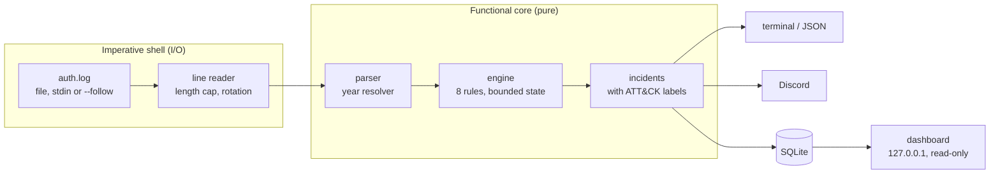

# How it works

The design, the detection details, and how the analyzer is tested and measured.
Back to the [README](../README.md). Each rule's tuning and false positives are in
[detections.md](detections.md).

## Measured quality

On a labelled corpus of 40 synthetic three-day logs (160 attacks, many deliberately below the thresholds, plus benign lookalikes) and on the Docker-lab recording, with default settings ([full results](evaluation.md), regenerated and checked by CI):

| Rule | Recall | Precision | Where it misses / what trips it |
|---|---|---|---|
| Brute force | 89% | 95% | misses 3–4 guesses; trips on several typos behind one NAT |
| Password spray | 69% | 100% | misses sprays of 3–5 accounts (below the default of 6) |
| Distributed brute force | 56% | 62% | misses 2–3 sources; trips on a misconfigured internal service (100% precision once internal networks are trusted) |
| New source | 100% | 38% | trips on travel and on the first users through an office NAT; inherent, hence never high |
| Log tampering | 96% | 76% | misses holes shorter than 2 hours; trips on maintenance downtime |

On the lab recording every labelled attack is caught with no false positives. The corpus was written by the same person as the rules, so it can only contain cases that were thought of: these numbers show where the thresholds sit, not how the tool will do on real traffic.

## Notes on the original four rules

### Brute force

Five or more failed logins from one IP within ten minutes, which are also fail2ban's defaults. Overlapping windows merge into one finding per attack, which lists the usernames tried and how many of them don't exist on the server.

The hard part is counting correctly. sshd records one failed attempt on several lines: a PAM "authentication failure" line, an "Invalid user" line, and a "Failed password" line. Only the `Failed …` line is counted; counting all of them would roughly double the total. The system logger also collapses repeated identical lines into `message repeated 5 times: [ … ]`, and that one line counts as five failures. In the sample, 16 of attacker A's 36 failures appear only inside such lines.

The rule uses a sliding window rather than a total for the whole file. With a total, a user who mistypes their password five times over a month would look like an attacker.

### Possible breach

For every successful login, the rule counts failed logins from the same IP in the previous 30 minutes. The severity split is what makes this rule useful. One failure a few seconds before a login is almost always a typo, as with bob in the sample, so it is low. Five or more, or a login during a brute force from that IP, is how a successful password-guessing attack looks, so it is high.

### Unusual hour

Successful SSH logins from 01:00 to 04:59, by the server's own clock. Times are never converted between timezones: "3 AM" means 3 AM where the server is. Cron jobs and other non-SSH sessions at night are ignored. The rule is low severity on its own, because it is context: it adds weight to a breach, and without one it is often just the on-call admin. The end hour is excluded so that the sample's nightly 05:30 backup job isn't flagged every day. Windows that cross midnight work too, for example `--night 22-6`.

### Account change

This rule watches the lines written by the standard account tools: `useradd` (a new user, plus any groups given with `-G`), `usermod -aG` and `gpasswd -a`. `adduser` is covered through the `useradd` and `gpasswd` calls it makes. It reports:

- **a new user**: low;
- **a user added to an admin group** (`sudo`, `wheel`, `admin`), **or a new user with UID 0**, which is a second root account: medium;
- **either of the above made from an IP that had already broken in**: high.

Being added to any other group, such as `docker`, is ignored. You can change the list of admin groups with `--admin-groups`.

## How the account-change rule finds the source IP

`useradd` and `usermod` don't record who ran them or from where. The log just says:

```text
useradd[5474]: new user: name=sysupdate, UID=1101, GID=1101, home=/home/sysupdate, shell=/bin/bash, from=/dev/pts/1
useradd[5474]: add 'sysupdate' to group 'sudo'
```

To tell whether the change followed a break-in, the rule has to work out the source IP itself. It takes four steps.

1. **Group the lines.** `useradd -G sudo` writes the new user and the group on separate lines from the same process. Lines with the same process ID and target user are merged into one change.

2. **Find who ran it.** The rule looks back for the most recent `sudo` line that:
   - is at most one minute earlier (`adduser` asks questions, so it allows time for typing),
   - runs one of `useradd`, `adduser`, `usermod` or `gpasswd`, and
   - names the same target user in its arguments.

   sudo logs the user who invoked it, so that gives the person:
   ```text
   sudo:   deploy : TTY=pts/1 ; PWD=/home/deploy ; USER=root ; COMMAND=/usr/sbin/useradd -m -s /bin/bash -G sudo sysupdate
   ```

3. **Rebuild the SSH sessions.** Every `Accepted …` line opens a session with a user, an IP and a start time. The line that ends it, `session closed for user deploy`, has no IP. But the same sshd process writes both lines, so they are matched by process ID. A session with no closing line counts as open until the end of the log.
   ```text
   sshd[5465]: Accepted password for deploy from 198.51.100.23 port 33951 ssh2
   sshd[5465]: pam_unix(sshd:session): session closed for user deploy
   ```

4. **Put them together.** The rule takes that person's sessions that were open when the change happened and collects their IPs. If any of those IPs had a high-severity possible breach before the change, the change is high and joins that IP's incident.

For attacker B: `deploy` logs in from 198.51.100.23 at 03:39 after 14 failed guesses. At 03:40 `deploy` runs `sudo useradd -G sudo sysupdate`. `deploy`'s only open session at that moment is the one from 198.51.100.23; the CI system's earlier `deploy` sessions had already closed. So the change is high severity, and it is reported under B's IP.

Only the sudo user's sessions are considered. That way, if an admin makes a legitimate change while an attacker happens to be logged in, the admin's action isn't blamed on the attacker's session. The sample includes this kind of legitimate change: dave onboards a new hire from the office and is reported as medium, not high.

**Limits:**
- If the change is made from a root shell (`sudo -i`, then `useradd`), there is no matching sudo line. The rule falls back to every open SSH session. It still escalates if a breached session is open, but the attribution is looser.
- If one user has sessions open from two IPs at once, the log doesn't say which terminal ran the command. Both IPs are reported, and the change is high if either IP broke in.
- Only a high-severity breach escalates a change. A login right after a single mistyped password doesn't.

## How it works inside

The code is a functional core with an imperative shell. Parsing and detection (`src/core/`) are pure and deterministic, with no I/O, no clock and no randomness, and a lint rule enforces that. Reading files, printing and exit codes live at the edges (`bin/`, `src/io/`).



The rules run on a **streaming engine**. Lines are read one at a time, parsed, and pushed into the engine; events are never collected into a list. Each rule keeps only the state it needs, such as one window of recent failures per IP or the SSH sessions currently open. That state is dropped as the log's own clock moves on, so memory doesn't grow with the length of the log. Findings appear as soon as a rule sees them and are updated when more evidence arrives. For example, a brute force is reported as medium and becomes high when the attacker logs in. This is what lets the same rules read a finished file and watch a live log.

Every kind of state also has a hard ceiling: 100,000 tracked IPs per rule, 5,000 recent failures per IP, 1,000 usernames per attack. Attacker IPs, breaches, and sessions with no logout are remembered for 7 days. If a ceiling is ever reached, for example by a botnet using more addresses than that, the oldest state is dropped and the report warns that activity may have been missed.

The engine was checked against the original implementation, which is kept unchanged in `test/reference/` for this purpose. A property-based test generates thousands of random event streams and requires both to report exactly the same incidents. The two differ in only three documented ways ([ADR-0007](adr/0007-streaming-engine-with-bounded-state.md)): the 7-day memory; ties within the same second, where the engine uses only lines it has already read; and incidents at the same time and severity, which are ordered by IP.

## Speed and memory

`npm run bench` generates a deliberately hostile synthetic log in memory: 70% of lines are single guesses from ever-new random IPs, as from a large botnet, mixed with brute-force bursts, logins, logouts and sudo noise. It then analyzes it. Measured on my Windows laptop with Node 24.21 for v1.0.0:

| 1M lines, all eight rules | time | live heap after GC at 25 / 50 / 75 / 100% |
|---|---|---|
| streaming (current) | 9.0–9.1 s, ~110,000 lines/s | 45 / 47 / 45 / 44 MB |
| collect, then analyze (the v0.1.0 approach) | 9.5 s | 93 / 182 / 270 / 360 MB |

The streaming time is from two repeat runs; the first run after a rebuild took 13.7 s. Memory is what matters here: streaming stays flat while collecting grows with the log. The collect path also can't run the log-tampering rule, which needs every line rather than only authentication events. At 4M lines the streaming run took 38.8 s (~103,000 lines/s), and its live heap was 43 / 50 / 56 / 57 MB at each million. The slow rise fits the findings kept for the final report, which grow with the number of attacks rather than lines (not yet measured separately). Resident memory (RSS) is higher than the live heap in both cases, because V8 holds on to memory it has freed.

## Testing

### Sample data with a known answer key

[`scripts/generate-sample-log.js`](../scripts/generate-sample-log.js) writes `samples/auth.log`. It uses a fixed random seed, so every run produces the same file and the expected results are always known. The normal background includes:
- five users logging in with keys or passwords and running sudo,
- cron jobs and CI deploys,
- 60 internet scanners, each making at most two password guesses.

External addresses come from the IP ranges reserved for documentation (RFC 5737), so no real host appears. Hidden inside are:

| | Scenario | Expected |
|---|---|---|
| A | Dictionary attack: 36 guesses at root and common account names; never gets in | brute force (medium) |
| B | Targeted guessing of `deploy`, logs in at 03:39, creates the sudo user `sysupdate` | all four rules (high) |
| C | On-call admin logs in over the VPN at 01:52 | unusual hour (low) |
| D | 4 failed guesses | nothing: one below the threshold |
| E | Nightly backup job logs in at 05:30 | nothing: just outside the night window |
| F | bob mistypes his password once, then logs in (3 times) | possible breach (low) |
| G | Admin creates a new hire's account, gives her sudo, adds bob to `docker` | account change (low and medium); `docker` ignored |

C through G are deliberate lookalikes. They check that the analyzer is right about what it *doesn't* flag, not only about what it does.

The sample predates the newer rules, which find three more things in it. The new-source rule reports B's login as `deploy` from a network `deploy` had never used, a true positive. It also reports two benign lookalikes at low severity, which are honest examples of that rule's inherent false positives: carol logging in from home over IPv6, and dave's on-call login over the VPN (C). The newer rules are measured on a separate labelled corpus instead (see [Measured quality](#measured-quality)).

### Real logs from a Docker lab

The synthetic sample only contains formats the generator knows about, so the analyzer is also tested on logs written by the real software. [`lab/`](../lab/README.md) is a Docker Compose lab: a Debian 13 server running OpenSSH 10 and rsyslog, an office workstation, and attackers on nine addresses, on an internal network with no route out. Its scenarios are normal admin work, a dictionary attack, a break-in that ends with a backdoor sudo user, a password spray across ten accounts, and a distributed attack on one account from five addresses.

`npm run lab` builds it, plays the scenarios, copies out `/var/log/auth.log` and checks it against [labels](../test/fixtures/lab/labels.json). CI does this on every pull request, and one recorded run is committed as a test fixture. The lab confirmed that the parser handles current formats (`sshd-session`, sudo 1.9 lines with no `TTY=`, RFC 3339 timestamps). It also exposed a false positive, since fixed: on a shared office IP, a colleague's key login right after someone else's typo counted as a possible breach.

### Test suites

137 tests using Node's built-in `node:test`. Run them with `npm test`. On Windows one is skipped (the SIGTERM test, since Windows has no catchable SIGTERM); CI runs all of them on Linux.

- `test/parse.test.js`: each line type, `message repeated` counting, spoofed usernames, IPv6, RFC 3339, the December-to-January year change, unreadable lines.
- `test/detectors.test.js`: each rule's thresholds and boundaries (4 vs 5 failures, a window exactly 10 minutes wide, 00:59 vs 01:00 vs 05:00), plus each way an account change can or can't be linked to a break-in.
- `test/lab-fixture.test.js`: the recorded lab log produces exactly its labelled incidents, the label check fails when an attack step is removed or an unlabelled attack is added, and current OpenSSH/sudo formats parse.
- `test/engine-equivalence.test.js`: fast-check generates thousands of random event streams (attacks, logins, sessions, sudo and account changes on a few IPs and users) and requires the engine and the frozen original rules to agree.
- `test/engine.test.js`: incremental findings, state staying under its caps with 100,000 attacking IPs, eviction as the log clock moves, the 7-day memory, and the same-second logout case the random test can't reach.
- `test/hostile-input.test.js`: lines split mid-character, the line-length cap (a 50 MB line never buffers more than 8 KiB), adversarial regex input under a time budget, escaped terminal output, and year inference.
- `test/rules.test.js`: the newer rules, each with what it must catch and the lookalikes it must not: scanner noise and office-NAT typos for spraying; roaming users, nonexistent accounts and IPv6 address rotation for distributed attacks; learning, first logins, shared and trusted networks for new sources; NTP steps and DST for tampering.
- `test/config.test.js`: the config file round trip, rejection of typos and wrong types, flags overriding the file, and the IP and network helpers.
- `test/follow.test.js`: the follower on real files: partial lines, rotation by rename, copytruncate, truncation, a file that disappears.
- `test/live-incidents.test.js`, `test/live.test.js`: incident events (one opened, one escalated), shutdown, truncation as tampering, the CLI with `--follow --json` and SIGTERM, `--discord` with the URL from `.env`, and a 100,000-line soak run with state bounded.
- `test/discord.test.js`: the Discord sink against a local mock webhook: dedup, hostile content kept inert, 429 with `retry_after`, 5xx retries, 4xx not retried, a slow server not blocking the caller, the rate limit, a full queue, and a hanging server at shutdown.
- `test/store.test.js`, `test/sql-rules.test.js`: what `--db` stores, drill-down from a finding to its raw lines, hostile strings stored as data, the schema version, read-only access, live mode storage, and the SQL rules matching the JavaScript ones.
- `test/dashboard.test.js`: hostile usernames rendered inert on every page, security headers on every response, methods, Host and cross-site refusal, result caps, and loopback-only binding.
- `test/attack.test.js`: the ATT&CK technique of every rule and kind of account change, and the labels in the terminal, JSON, live JSON lines and SQLite, plus the links in `docs/detections.md`.
- `test/sample.test.js`: an end-to-end check that the sample log produces exactly the incidents in its answer key ([full report](usage.md#the-full-report-for-the-sample-log)), plus the command line (exit codes, `--json`, stdin, bad arguments).

### Planted-bug testing

Tests that have never failed haven't proved they can catch anything. So after each feature, I planted small bugs in the code on purpose, one at a time, and checked that at least one test failed. Examples:

- raising the brute-force threshold from 5 to 6;
- making the window edge exclusive;
- ignoring the count in `message repeated` lines;
- letting a break-in that happens *after* an account change escalate it;
- ignoring logouts, so sessions never close;
- ignoring which user ran sudo.

Of 11 planted bugs, two survived at first. Both were real gaps in the tests:

- **The spoofed-username test passed for the wrong reason.** The parser matches usernames greedily so that the last `from … port …` on the line wins. Switching to a lazy match should have broken the test, but it didn't: the test's fake username was rejected by the end-of-line anchor anyway. The test now uses a username containing `ssh2: …`, which a lazy match really does misread.
- **No test covered a break-in after the change.** Nothing checked that a break-in occurring *after* an account change leaves the change un-escalated. A test was added.

One lesson from the process: a planted bug that doesn't actually apply gives the same "0 tests failed" as a real gap. The script therefore checks that the source file really changed before trusting the result. That check caught one planted bug that hadn't applied.

The same was done for the streaming engine's new code paths, the ones with no counterpart in the original:

- never escalating a low possible breach when a brute force turns up later;
- ignoring a breach that became high after an account change;
- forgetting logins that came before an attack became visible;
- an exclusive window edge;
- forgetting low findings too soon;
- dropping a session whose PID is reused;
- not counting a session that logged out in the same second as the change.

The random equivalence test caught six of the seven. The seventh survived because the generator never puts two actions in the same second. A targeted test now covers it, and catches it.

For the four newer rules the tests were written alongside the rules rather than strictly first, so planted bugs were used to check them. Eleven were planted: off-by-one thresholds, counting nonexistent accounts, forgetting the typo exemption, alerting during learning, comparing exact addresses instead of networks, dropping the DST allowance, measuring gaps from the wrong line, never reporting a held-back login, and counting IPv6 per address. All eleven were caught. The labelled evaluation then found three bugs that no test had:

- steps across the end of DST misread as tampering when the lines were minutes apart;
- logins from trusted networks not building the new-source baseline;
- a flood of new-source alerts for every first login through an office NAT, fixed by treating a network that several colleagues use as known.

## Development

```sh
npm ci              # install the development tools (there are no runtime dependencies)
npm run check       # lint, type check and tests, exactly as CI runs them
```

- **Lint:** ESLint with the recommended rules plus `no-eval`, `no-implied-eval` and `no-new-func`.
- **Types:** JSDoc annotations checked by `tsc --checkJs` in strict mode. There is no build step; the `.js` files run as they are.
- **CI:** every pull request runs lint, type check, and tests on Node 22 and 24. `main` only accepts pull requests whose checks pass.

The plan and the reasoning behind it live in [SPEC.md](../SPEC.md) (goals, non-goals, acceptance criteria), [PLAN.md](../PLAN.md) (tasks and how each is verified) and [docs/adr/](adr/) (architecture decision records).

## Project layout

```text
bin/analyze.js                  command line: options, reading the file or stdin, exit codes
src/core/                       the pure core: parser, year inference, engine, rules, incidents, ATT&CK mapping
src/core/rules/                 one file per detection (eight rules)
src/io/                         reading lines from files and stdin; the streaming analysis
src/io/follow.js, src/io/live.js  following a log through rotation; live mode
src/io/sinks/                   live outputs: terminal, JSON lines, Discord
src/io/store.js, sql-rules.js   SQLite storage, drill-down, and two rules in SQL
bin/dashboard.js, src/dashboard/  local read-only dashboard: server, queries, HTML views
src/parse.js, src/detectors.js  stable entry points: parseLines(), analyze()
src/report.js                   terminal and JSON output
src/types.js                    shared JSDoc types (events, findings, options)
scripts/generate-sample-log.js  synthetic auth.log with a known answer key
samples/auth.log                the generated sample
scripts/lab.js                  runs the Docker lab and checks its log against labels
lab/                            Docker lab: SSH target, clients, attack scenarios
scripts/bench.js                speed and memory benchmark
scripts/eval.js                 precision and recall on labelled data, written to docs/evaluation.md
scripts/lib/corpus.js           the seeded, labelled synthetic corpus
docs/detections.md              every rule: what it reads, tuning, false positives
log-analyzer.config.example.json  every setting at its default
test/                           parser, detector, engine, hostile-input, end-to-end and lab tests
test/reference/                 the original batch rules, frozen, as a test oracle
test/fixtures/lab/              a recorded lab auth.log and its labels
docs/adr/                       architecture decision records
```
