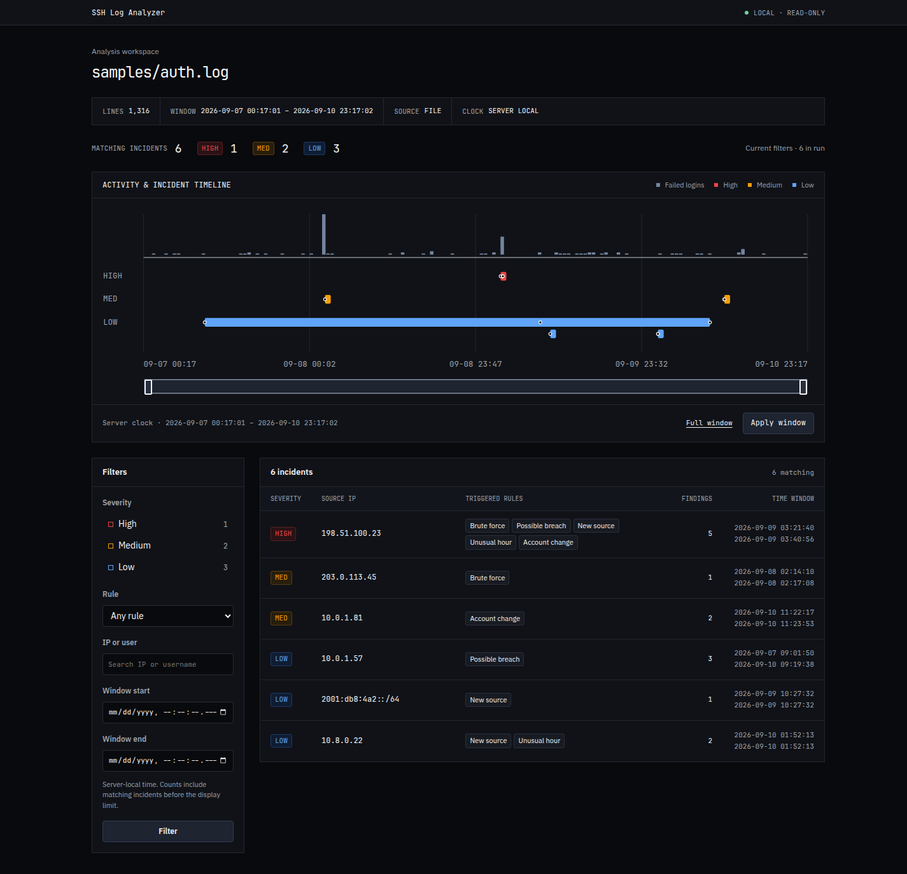
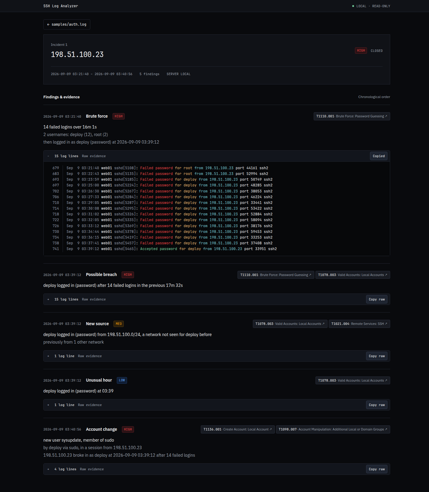

# Usage

How to run the analyzer, every option, live mode, alerts, storage and the
dashboard. Back to the [README](../README.md).

## Running it

Requires Node.js 22.13 or later (24 recommended).

```sh
node bin/analyze.js samples/auth.log            # terminal report
node bin/analyze.js samples/auth.log --json     # machine-readable output
sudo cat /var/log/auth.log | node bin/analyze.js -   # read from stdin
sudo node bin/analyze.js --follow /var/log/auth.log  # watch live, report incidents as they happen
npm test                                        # run the tests
npm run generate-sample                         # rebuild samples/auth.log
```

```text
Options:
  --json              Print the results as JSON (with --follow: one JSON object per line)
  --follow            Keep watching the log, through rotation, and report incidents as they happen
  --from-start        With --follow, read what is already in the file first
  --discord           Send alerts to the Discord webhook in DISCORD_WEBHOOK_URL (or .env)
  --config <file>     Settings file (default log-analyzer.config.json, if it exists)
  --print-config      Print the effective settings as a config file and exit
  --threshold <n>     Failed logins from one IP that count as brute force (default 5)
  --window <time>     ...within this window, e.g. 90s, 10m, 1h (default 10m)
  --lookback <time>   How far before a login to look for failures (default 30m)
  --night <from-to>   Unusual login hours on a 24h clock, end excluded (default 1-5)
  --admin-groups <g>  Comma-separated groups that grant admin rights (default sudo,wheel,admin)
  --year <yyyy>       Year of the first line; syslog timestamps have none (default: guessed)
  -h, --help          Show this help
```

The exit status is 0 if nothing high-severity was found, 1 if something was, and 2 for bad arguments, a bad config file, or an unreadable log, so the tool can gate a cron job or CI step.

### Configuration

Every rule's settings can go in one JSON file. Copy [log-analyzer.config.example.json](../log-analyzer.config.example.json), which lists every setting at its default, to `log-analyzer.config.json` and change what you need. Unknown keys and wrong types are errors, not silently ignored, and durations always carry a unit (`"90s"`, `"10m"`, `"1h"`, `"7d"`). Flags override the file. For example, to stop the new-source and distributed rules from reporting your own internal networks:

```json
{ "trustedNetworks": ["10.0.0.0/8"] }
```

### Live mode

`--follow` watches the log as it is written, like `tail -F`, and reports each incident as it opens, escalates (a brute force becoming a break-in), or gains a new kind of finding:

```text
2026-10-17 10:46:37  MEDIUM (new)  172.30.0.77  brute force: 5 failed logins over 13s
                                   2 usernames: deploy (3), root (2)
                                   never logged in
2026-10-17 10:46:37  HIGH (now)    172.30.0.77  brute force: 10 failed logins over 28s
                                   2 usernames: deploy (8), root (2)
                                   then logged in as deploy (password) at 2026-10-17 10:47:07
2026-10-17 10:47:07  HIGH (also)   172.30.0.77  possible breach: deploy logged in (password) after 10 failed logins in the previous 30s
2026-10-17 10:47:09  HIGH (also)   172.30.0.77  account change: new user sysupdate, member of sudo
                                   by deploy via sudo, in a session from 172.30.0.77
                                   172.30.0.77 broke in as deploy at 2026-10-17 10:47:07 after 10 failed logins
```

That is the Docker-lab break-in, replayed into a file a few lines at a time: the attack is reported at its fifth guess, escalated when the attacker gets in, and the backdoor account joins the same incident. `(also)` lines are new findings in an incident that is already open; they don't send a second Discord alert.

It survives logrotate in both modes (rename-and-create, and copytruncate) and the file briefly disappearing. It reports the file shrinking with no rotated copy beside it as log tampering, at high severity. Memory stays flat, because rule state is bounded and incidents close after 24 hours without news (`live.incidentIdle`). Ctrl+C or SIGTERM stops it cleanly: it reads what is left, closes the open incidents, and gives pending alerts up to 5 seconds. With `--json`, each incident event is one JSON object per line, for piping into other tools.

### Discord alerts

`--discord` sends one alert when an incident opens at medium or above, and one more when it escalates: one attack is one alert, however many lines it writes. Alerts are queued and rate-limited (5 at once, then 20 a minute), retried with backoff when Discord is busy, and never slow detection down. Log content in an alert sits inside a code block with mentions disabled, so a username like `@everyone` or a markdown link stays inert text.

To set it up, create a webhook in Discord (Server Settings → Integrations → Webhooks → New Webhook → Copy Webhook URL). Then put it in a `.env` file next to where you run the tool. `.env` is git-ignored, and [.env.example](../.env.example) shows the format:

```sh
DISCORD_WEBHOOK_URL=https://discord.com/api/webhooks/<id>/<token>
```

The tool reads it with Node's own `.env` support and never prints it. Thresholds live in the config file under `discord` (`minSeverity`, `burst`, `perMinute`). `--discord` also works without `--follow`, sending one alert per incident in the report, which suits a nightly cron job.

### Storing results (SQLite)

`--db runs.db` also stores the run in a SQLite file: every line, the events parsed from them, and the incidents and findings. It works for a one-off analysis and with `--follow`, where each incident is updated as it changes. It uses Node's built-in `node:sqlite`, so nothing extra is installed, and is loaded only when asked for (on Node 22, `node:sqlite` still prints an experimental warning). All SQL is parameterized: log content is always data.

```sh
node bin/analyze.js samples/auth.log --db runs.db
```

Two rules, brute force and unusual hour, are also written in SQL (`src/io/sql-rules.js`). They are a second, independent implementation. Tests require them to produce exactly the findings of the JavaScript rules on the sample, the lab recording, 29 corpus logs, and 300 random event streams. The one exception is logs with spliced lines, which the tampering rule reports: there the streaming engine follows file order while SQL orders by time ([ADR-0015](adr/0015-sqlite-storage.md)).
### Dashboard

A local web view of a database written with `--db`: a timeline of failed logins with each incident marked on it, filters by severity, rule, IP or username and server-local time window, and every incident's findings down to the raw log lines behind them.

```sh
node bin/analyze.js samples/auth.log --db runs.db
npm run dashboard -- --db runs.db      # http://127.0.0.1:4797/ (--port, --ipv6)
```





Log content is hostile, so the dashboard is deliberately narrow ([ADR-0016](adr/0016-local-read-only-dashboard.md), [ADR-0018](adr/0018-dashboard-interactions.md)): it listens on loopback only and answers only its own `Host` (against DNS rebinding) and not requests from other sites, serves GET and HEAD only, and opens the database read-only. A small local script enables the brush, tooltips and clipboard; fonts are bundled locally. CSP forbids inline execution and external resources. Every log field is escaped, including control characters and bidi overrides; tests render hostile usernames into every page and check they come out as text.

Drag either range handle or use the keyboard arrows, then select **Apply window**.
The date inputs provide the same filter without JavaScript. Time bounds include
incidents whose first-to-last finding span overlaps the selected window; all
times use the log server's clock, without a browser-timezone conversion. The
histogram retains full-run context. **Full window** removes only the time bounds;
**Reset** removes all filters. Incident links and the breadcrumb preserve filters.

**Copy raw** copies the displayed stored evidence without gutter numbers. Control
characters remain visible escapes. If the clipboard is unavailable, open evidence
receives focus for manual selection. More than 500 matching incidents are counted
in full but only 500 are displayed; the chart shows at most 40 priority incidents.

## Log formats

- Classic syslog timestamps (`Sep  7 03:39:12`). These have no year. The first line takes `--year`, or else the most recent year that doesn't put it in the future. Each later line takes whichever year puts it closest to the line before, so New Year works in both directions: Dec 31 → Jan 1 moves to the next year, and a late Dec 31 line arriving after Jan 1 stays in the old one.
- RFC 3339 timestamps (`2026-09-07T03:39:12.123456+00:00`), used by newer Debian and Ubuntu. The offset is ignored so times stay on the server clock.
- `sshd`, and the `sshd-session` and `sshd-auth` processes used by OpenSSH 9.8 and later.
- IPv6 addresses, Windows (CRLF) line endings, and input from stdin.
- **Spoofed usernames.** Usernames come from the attacker and can contain text like `from 10.0.0.1 port 22`. The parser always takes the *last* `from … port …` on the line, which sshd itself writes.
- Lines in no recognized format are counted and reported, not treated as errors.
- **Hostile input.** Lines over 8 KiB are skipped and counted rather than buffered; sshd's own lines are far shorter. Every log-derived field in the terminal report is escaped, so a forged line can't send terminal escape sequences, fake extra report lines with newlines, or reorder text with Unicode bidi overrides. Adversarial lines of 7–8 KB parse in well under 5 ms each, and a test enforces that.

## The full report for the sample log

This is the terminal report for `samples/auth.log`, a synthetic four-day log with
attacks hidden among normal traffic (see [how it works](how-it-works.md#sample-data-with-a-known-answer-key)):

```text
SSH auth log analysis: samples/auth.log
1,316 lines, 2026-09-07 00:17:01 to 2026-09-10 23:17:02
116 failed logins, 44 successful logins

Rules:
  brute force      5+ failed logins from one IP within 10m
  possible breach  a login from an IP with failed logins in the previous 30m
  unusual hour     a login between 01:00 and 04:59
  account change   a new user, or a user added to sudo/wheel/admin; high if made from an IP that broke in
  password spray   6+ real accounts from one source within 1h, at most 2 tries each
  distributed      one account guessed from 4+ sources (8+ failures) within 1h
  new source       a login from a network the user hasn't logged in from before (after 24h of learning)
  log tampering    no lines for 2h, time going back 5m+, NUL bytes, or truncation

HIGH    198.51.100.23
  2026-09-09 03:21:40  brute force      14 failed logins over 16m 1s
                                        2 usernames: deploy (12), root (2)
                                        then logged in as deploy (password) at 2026-09-09 03:39:12
                                        ATT&CK T1110.001 Brute Force: Password Guessing
  2026-09-09 03:39:12  possible breach  deploy logged in (password) after 14 failed logins in the previous 17m 32s
                                        ATT&CK T1110.001 Brute Force: Password Guessing, T1078.003 Valid Accounts: Local Accounts
  2026-09-09 03:39:12  new source       deploy logged in (password) from 198.51.100.0/24, a network not seen for deploy before
                                        previously from 1 other network
                                        ATT&CK T1078.003 Valid Accounts: Local Accounts, T1021.004 Remote Services: SSH
  2026-09-09 03:39:12  unusual hour     deploy logged in (password) at 03:39
                                        ATT&CK T1078.003 Valid Accounts: Local Accounts
  2026-09-09 03:40:56  account change   new user sysupdate, member of sudo
                                        by deploy via sudo, in a session from 198.51.100.23
                                        198.51.100.23 broke in as deploy at 2026-09-09 03:39:12 after 14 failed logins
                                        ATT&CK T1136.001 Create Account: Local Account, T1098.007 Account Manipulation: Additional Local or Domain Groups

MEDIUM  203.0.113.45
  2026-09-08 02:14:10  brute force      36 failed logins over 2m 58s
                                        16 usernames, 15 nonexistent: root (18), admin (4), administrator (1), ftpuser (1), git (1), +11 more
                                        never logged in
                                        ATT&CK T1110.001 Brute Force: Password Guessing

MEDIUM  10.0.1.81
  2026-09-10 11:22:17  account change   new user erin
                                        by dave via sudo, in a session from 10.0.1.81
                                        ATT&CK T1136.001 Create Account: Local Account
  2026-09-10 11:23:53  account change   erin added to sudo
                                        by dave via sudo, in a session from 10.0.1.81
                                        ATT&CK T1098.007 Account Manipulation: Additional Local or Domain Groups

LOW     10.0.1.57
  2026-09-07 09:01:50  possible breach  bob logged in (password) 6s after 1 failed login
                                        ATT&CK T1110.001 Brute Force: Password Guessing, T1078.003 Valid Accounts: Local Accounts
  2026-09-09 09:03:04  possible breach  bob logged in (password) 5s after 1 failed login
                                        ATT&CK T1110.001 Brute Force: Password Guessing, T1078.003 Valid Accounts: Local Accounts
  2026-09-10 09:19:38  possible breach  bob logged in (password) 6s after 1 failed login
                                        ATT&CK T1110.001 Brute Force: Password Guessing, T1078.003 Valid Accounts: Local Accounts

LOW     2001:db8:4a2::/64
  2026-09-09 10:27:32  new source       carol logged in (publickey) from 2001:db8:4a2::/64, a network not seen for carol before
                                        previously from 1 other network
                                        ATT&CK T1078.003 Valid Accounts: Local Accounts, T1021.004 Remote Services: SSH

LOW     10.8.0.22
  2026-09-10 01:52:13  new source       dave logged in (publickey) from 10.8.0.0/24, a network not seen for dave before
                                        previously from 1 other network
                                        ATT&CK T1078.003 Valid Accounts: Local Accounts, T1021.004 Remote Services: SSH
  2026-09-10 01:52:13  unusual hour     dave logged in (publickey) at 01:52
                                        ATT&CK T1078.003 Valid Accounts: Local Accounts

6 incidents: 1 high, 2 medium, 3 low
```


